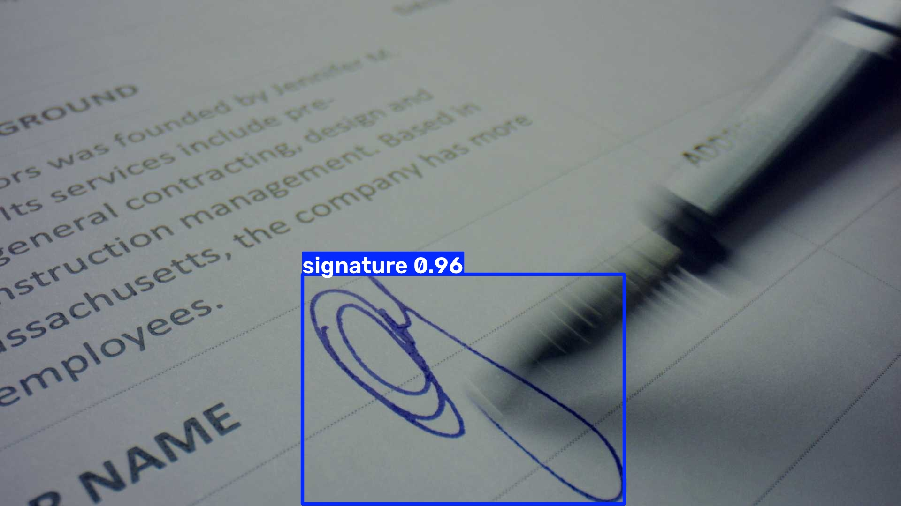
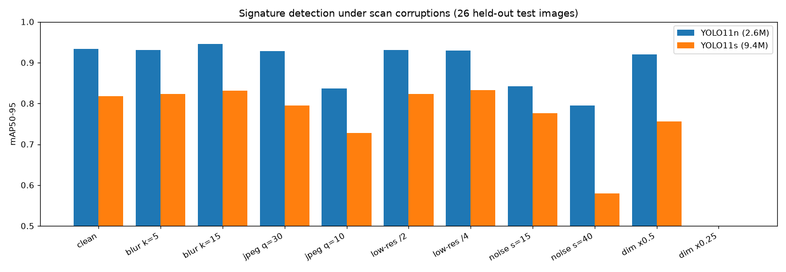

# sigdet

[](https://github.com/shaikn6/sigdet/actions/workflows/ci.yml)
[](LICENSE)
[](.github/workflows/ci.yml)

**A YOLO11 signature detector for scanned documents, scored on a test split with no near-duplicate leakage and
stress-tested under scan and photo corruptions.**

Document **signature detection** with YOLO11, fine-tuned on the public Ultralytics signature dataset
with a **leakage-aware train/val/test split** (110 train / 26 val / 26 test; `make_split.py`), plus a
**robustness study**: how detection quality degrades under realistic scan and photo corruptions.
Relevant to KYC, cheque, and contract-processing pipelines. To run it on your own scan, see [Use](#use).



## Results

The 178 images are every-2nd-frame grabs from two short videos, so adjacent frames are near-duplicates.
`make_split.py` cuts each clip into contiguous chunks and holds out whole chunks for val and test (dropping
the train frames next to them), so no near-copy of a test image sits in train; it also checks by file hash
that no image appears in two splits (`python make_split.py --check`). **Val selects the checkpoint and the
training recipe; the test split is scored once and never used for selection.**

Shipped weights (`weights/`): 100 epochs, batch 8, 640 px, seed 0, trained on one Tesla T4 (torch 2.14.1,
ultralytics 8.4.191, AMP on) and re-scored on an Apple M2 Pro with `bench.py` (`bench.json`). The 95% interval
resamples the 26 images (2,000 draws).

| Model | Params | Split | mAP50 | mAP50-95 (95% interval) | Precision | Recall |
|---|---|---|---|---|---|---|
| **YOLO11n** | 2.6M | val | 0.994 | 0.976 (0.952 to 0.992) | 0.964 | 0.962 |
| **YOLO11n** | 2.6M | **test** | 0.995 | **0.934** (0.902 to 0.965) | 0.998 | 1.000 |
| YOLO11s | 9.4M | val | 0.994 | 0.929 (0.872 to 0.973) | 0.999 | 0.962 |
| YOLO11s | 9.4M | **test** | 0.995 | **0.817** (0.771 to 0.879) | 0.997 | 1.000 |

mAP50 is saturated (0.995) on test, so the useful signal is mAP50-95, which drops from val to the held-out test.
**`n` is the better and the more stable model on this data**; the larger `s` is worse and varies more from seed
to seed (below). `n` is the shipped model (`weights/signature_yolo11n.pt`) and is also faster on this Mac:
15.3 ms vs 19.8 ms per image on the GPU (MPS) and 35.2 ms vs 55.9 ms on CPU (p50, `bench.py`). `s` is committed
so `bench.py` and `robustness.py` run from a fresh clone.

### Seeds and training recipe

A single run on 26 test images is noisy, so four recipes were each trained with three seeds per size
(24 runs, `scripts/modal_grid.py`, all on a T4; raw per-run numbers in `results/grid.json`). The recipe was
chosen by **mean validation mAP50-95** before looking at test: 100 epochs at batch 8 won for both sizes.
Mean ± standard deviation over seeds 0, 1, 2:

| Size | Recipe | val mAP50-95 | test mAP50-95 |
|---|---|---|---|
| n | 60 epochs, batch 16 (earlier recipe) | 0.957 ± 0.018 | 0.909 ± 0.010 |
| n | 150 epochs, batch 16 | 0.965 ± 0.013 | 0.909 ± 0.040 |
| n | **100 epochs, batch 8 (chosen)** | **0.980 ± 0.004** | **0.939 ± 0.005** |
| n | 100 epochs, batch 8, 800 px | 0.977 ± 0.004 | 0.930 ± 0.027 |
| s | 60 epochs, batch 16 (earlier recipe) | 0.853 ± 0.074 | 0.799 ± 0.088 |
| s | 150 epochs, batch 16 | 0.936 ± 0.035 | 0.834 ± 0.036 |
| s | **100 epochs, batch 8 (chosen)** | **0.945 ± 0.015** | **0.859 ± 0.041** |
| s | 100 epochs, batch 8, 800 px | 0.880 ± 0.036 | 0.779 ± 0.118 |

The earlier 60-epoch, batch-16 recipe is only about 420 optimizer steps on 110 images; both models sit near
zero mAP for the first 15 to 30 epochs, and `s` was unstable. The shipped seed-0 weights are not the best seed
(for `s` the three test scores are 0.817, 0.861 and 0.899), they are the pre-declared seed.

GPU kernels are not bit-exact, so a rerun with seed 0 lands inside the spread above rather than on the same
digits. Training curves of the shipped weights: `results/train_n.csv`, `results/train_s.csv`.

**History:** the weights committed before 2026-10-28 were trained on the stock Ultralytics split, which
contains 22 of the 26 test images, so their test score (0.99) was not held out. Earlier versions of this
README reported 0.904 and 0.905 for `n` and `s`, and a robustness table, from a model that was never committed.
All numbers here come from the committed weights.

### Things tried that did not help

Two cheap inference-time levers were checked on the **validation** split only (`scripts/fusion_probe.py`,
`results/fusion_probe.json`, shipped seed-0 weights); neither cleared a +0.005 mAP50-95 gain on validation in the
repo's own evaluator, so the test split was not scored for them and nothing changed in the shipped model.

| Lever (val mAP50-95) | n | s |
|---|---|---|
| plain (`model.val`, as in `bench.py`) | 0.976 | 0.929 |
| ultralytics test-time augmentation (`augment=True`) | 0.970 | 0.946 |
| weighted boxes fusion of n and s (best of 6 weight / IoU settings) | 0.955 | |
| weighted boxes fusion of n, s and both TTA outputs (best of 6) | 0.959 | |

- TTA helps `s` (+0.017) but not `n` (-0.006), and `s` with TTA is still below plain `n`. Scored through
  `model.predict` instead of `model.val` (different letterboxing), TTA moves `n` by +0.010 instead: on 26 images the
  sign of a 0.01 change depends on preprocessing, so it is noise, not a gain.
- Fusing `n` with the weaker `s` pulls boxes towards the looser model and lowers mAP50-95 at every setting tried
  (the fusion rows are scored through `model.predict`, where plain `n` is 0.966).

## Robustness

Each corruption is applied to the 26 held-out **test** images (labels unchanged) and the shipped model is
re-scored (`robustness.py`, `robustness.json`). Single run; the noise is random and `n` and `s` see different
noise draws.



mAP50-95 change from the clean score (`n` 0.934, `s` 0.817):

| Corruption | n | s |
|---|---|---|
| blur k=5 / k=15 | -0.004 / +0.011 | +0.006 / +0.014 |
| JPEG q=30 / q=10 | -0.006 / **-0.098** | -0.023 / -0.090 |
| low-res /2 / /4 | -0.004 / -0.004 | +0.006 / +0.015 |
| noise s=15 / s=40 | -0.092 / **-0.140** | -0.041 / **-0.237** |
| dim x0.5 / x0.25 | -0.013 / **-0.519** | -0.061 / -0.355 |

- Blur, 2x and 4x downsampling and JPEG q=30 change mAP50-95 by at most a few points either way; on 26 images
  differences of that size are noise.
- **Severe under-exposure is the worst case:** at 0.25x brightness `n` loses half of its mAP50-95 (0.415) and
  its mAP50 falls to 0.813, so it starts to miss signatures, not just box them loosely. Phone photos of
  documents in poor light are the main risk.
- Heavy JPEG compression (q=10) and sensor noise cost `n` 9 to 14 points of box tightness.
- `s` is not more robust than `n` overall: it is worse on noise s=40 (-0.237) and has a lower clean score.

## Caveats

The dataset is small (178 images from two videos). 26 test images give a usable but noisy estimate, which is
why the intervals above are wide and why seeds matter. The `clean` row in `robustness.json` re-scores re-encoded
copies in a separate pass, so it can differ from the test row in `bench.json` by a few thousandths. Corruptions
are synthetic approximations of scan artefacts, and rotation is excluded (it would need box re-derivation).
Latency is measured on an Apple M2 Pro and will differ elsewhere.

## Use

```bash
pip install -r requirements.txt
python detect.py scan.jpg --out annotated.jpg        # prints JSON boxes
python make_split.py                                   # build the leakage-aware split (needs the dataset); --check only verifies
python train.py n s                                    # retrain with the chosen recipe; --device auto|cpu|mps|cuda:0
python bench.py && python robustness.py n s            # regenerate bench.json / robustness.json (test split)
python plot_robustness.py                              # redraw robustness.png from robustness.json
python -m pytest tests
```

`train.py`, `bench.py` and `robustness.py` pick CUDA, then Apple MPS, then CPU unless `--device` says otherwise.
CI runs lint, a compile check, and the tests. Tests that need the dataset under `~/datasets/signature` are
skipped on CI; the smoke tests (`detect()` on the committed `sample.jpg`), the split-manifest check and the
check that the committed weights were trained on the leakage-aware split with the documented recipe run
everywhere.

## License

AGPL-3.0. The dataset and the `ultralytics` library are AGPL-3.0, and this repo is licensed to match.
